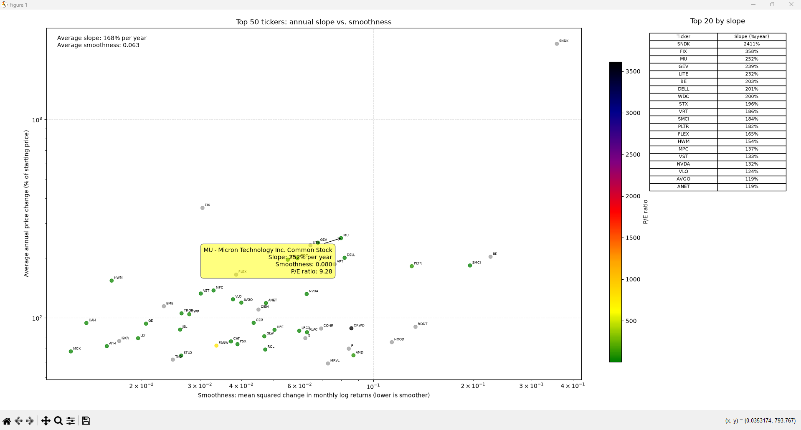

# Value Slope

Value Slope compares annualized stock-price changes with return smoothness for S&P 500 tickers. It loads market data with KaggleHub, analyzes the latest five-year period, displays a chart of the 50 tickers with the highest annualized price change, and exports the chart data for the static web page.

## Features

- Calculates annualized price change from each ticker's first and last valid monthly closing prices.
- Measures return smoothness as the mean squared change in monthly log returns; lower values indicate smoother returns.
- Labels each plotted point with its ticker; hovering shows the company name, slope, smoothness, and P/E ratio.
- Displays average slope with no decimal places and average smoothness with three decimal places. Hover details use the same slope and smoothness precision; missing P/E ratios display as `N/A`.
- Includes a table of the top 20 tickers ranked by annualized slope, with slopes shown as whole percentages.
- Colors data points by P/E ratio from low to high: green, yellow, orange, red, purple, dark blue, and black; missing or nonpositive ratios are gray.
- Uses logarithmic scales for both axes. Values must be positive to appear on a logarithmic axis.
- Generates `value-slope.json` from the same prepared data used by the Python chart and table.

## Requirements

Python and the following packages:

- `kagglehub[pandas-datasets]`
- `matplotlib`
- `mplcursors`
- `numpy`
- `pandas`

## Installation

Install the required packages:

```powershell
python -m pip install "kagglehub[pandas-datasets]" matplotlib mplcursors numpy pandas
```

## Usage

Run the script from the project directory:

```powershell
python value-slope.py
```

The script loads `SnP_daily_update.csv` from the Kaggle dataset, opens the chart in a Matplotlib window, and writes `value-slope.json` beside the script. It also prints each plotted ticker's annualized slope and smoothness to the console.

Company names and P/E ratios are loaded from external CSV datasets. P/E data comes from the [S&P 500 companies financials dataset](https://datahub.io/core/s-and-p-500-companies-financials/_r/-/data/constituents-financials.csv). The color scale is relative to the plotted tickers.

### Static web page

The standalone `index.html` reads `value-slope.json` from the same directory and displays the interactive chart, hover details, averages, and top-20 table. Plotly is loaded from its public CDN, so viewers need an internet connection.

To publish or refresh the page manually:

1. Run the Python script to regenerate `value-slope.json`.
2. Upload `index.html` and `value-slope.json` together to the published GitHub Pages directory.

For local testing, serve the files over HTTP rather than opening `index.html` as a `file://` URL, since browsers restrict local JSON fetches.

## Chart



## Project structure

```text
value-slope/
├── README.md
├── index.html
├── screenshot.png
├── value-slope.py
└── value-slope.json  # generated by running the script
```
